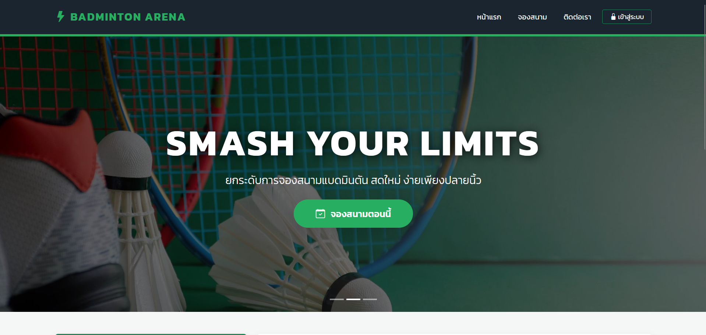
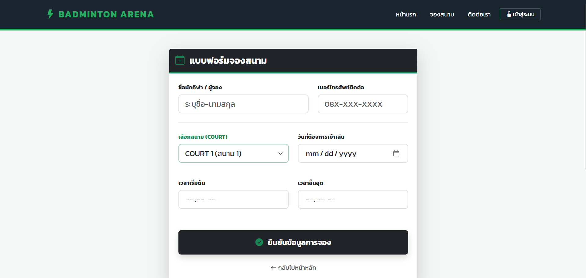

# 🏸 Badminton Court Booking System
ระบบจองสนามแบดมินตันออนไลน์ พัฒนาด้วย Django Framework

## ฟีเจอร์หลัก
- **Auto-Slider Hero:** หน้าแรกสวยงามพร้อมภาพสไลด์อัตโนมัติ
- **Smart Booking Check:** ระบบป้องกันการจองสนามซ้ำในเวลาเดียวกัน
- **Search System:** ค้นหาประวัติการจองด้วยชื่อนักกีฬาหรือเลขสนาม
- **Live Status:** แสดงสถานะการจองแบบ Real-time (LIVE/Finished)
- **Delete Confirmation:** ระบบยืนยันการลบด้วย SweetAlert2

## ตัวอย่างหน้าเว็บไซต์



## การติดตั้ง
```bash
git clone https://github.com/lakkanaTF-prog/badminton-booking-project.git
cd badminton_project
python -m venv venv
venv\Scripts\activate
pip install -r requirements.txt
python manage.py migrate
python manage.py runserver
```

## วิธีใช้งาน
- เพิ่มการจองสนาม
- ค้นหาข้อมูลด้วย 2 เงื่อนไข
- แก้ไขข้อมูล
- ลบข้อมูลพร้อม popup
- ตรวจสอบสถานะการจอง
- **ตรวจสอบสถานะการจอง:** แสดงสถานะ Real-time (LIVE/Finished)

## 🔐 การจัดการสิทธิ์ (Role-based Access)
ระบบมีการแยกสิทธิ์ผู้ใช้งานชัดเจนเพื่อความปลอดภัยของข้อมูล:
- **ผู้ใช้งานทั่วไป:** สามารถดูรายการจอง ค้นหาข้อมูล และทำการจองสนามใหม่ได้
- **ผู้ดูแลระบบ (Admin):** ต้องเข้าสู่ระบบ (Login) เพื่อใช้งานฟังก์ชัน **แก้ไข** และ **ลบ** ข้อมูล

## 👥 สมาชิกในกลุ่ม (ICT12367)
- น.ส.ลักขณา ป้อมยุคล 68089078
- นาย ภัทรพล สงทอง 68078466
- นาย อภิชัย เทพรักษ์ 68079865
- นาย ธนกฤต ทิพวัฒน์ 68082011